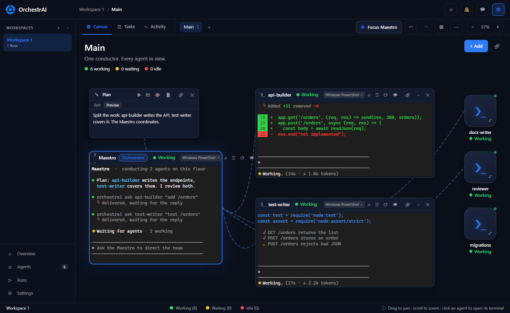
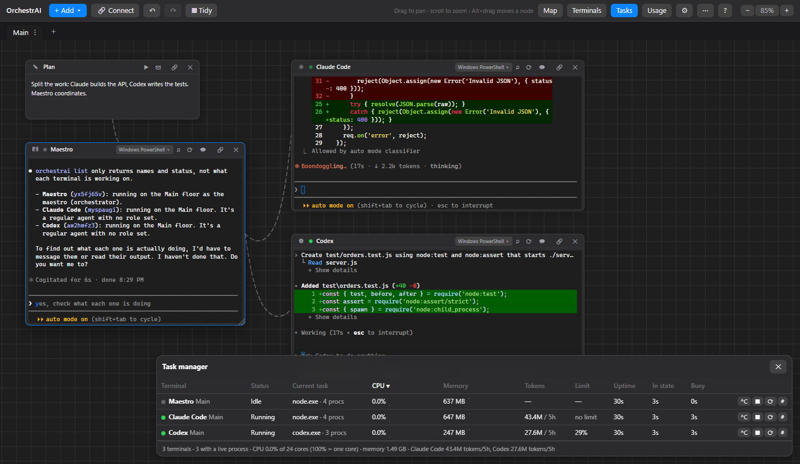
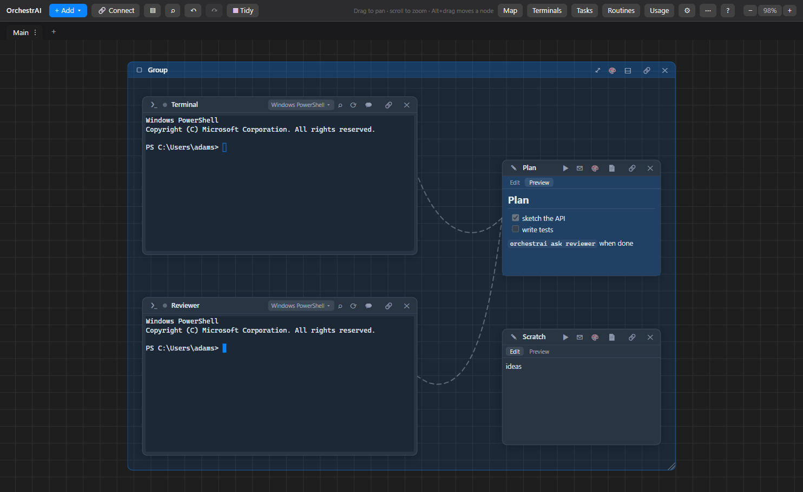
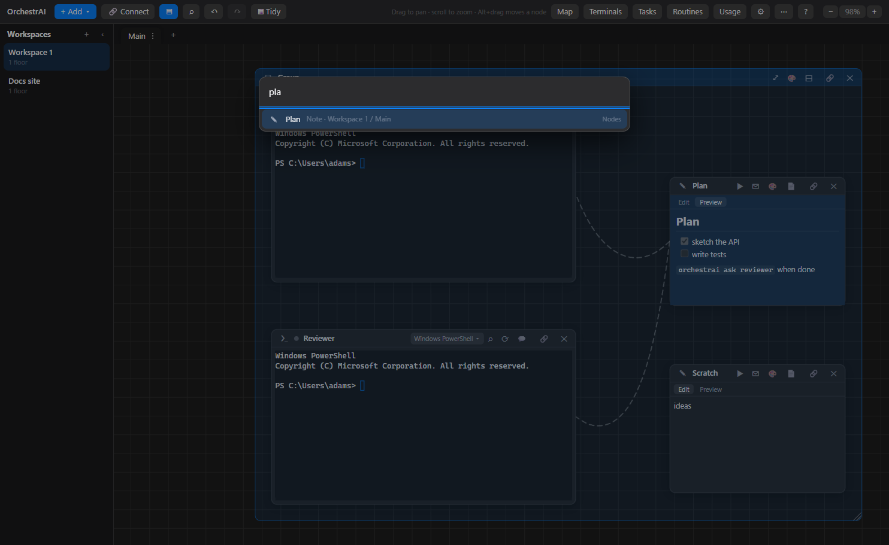
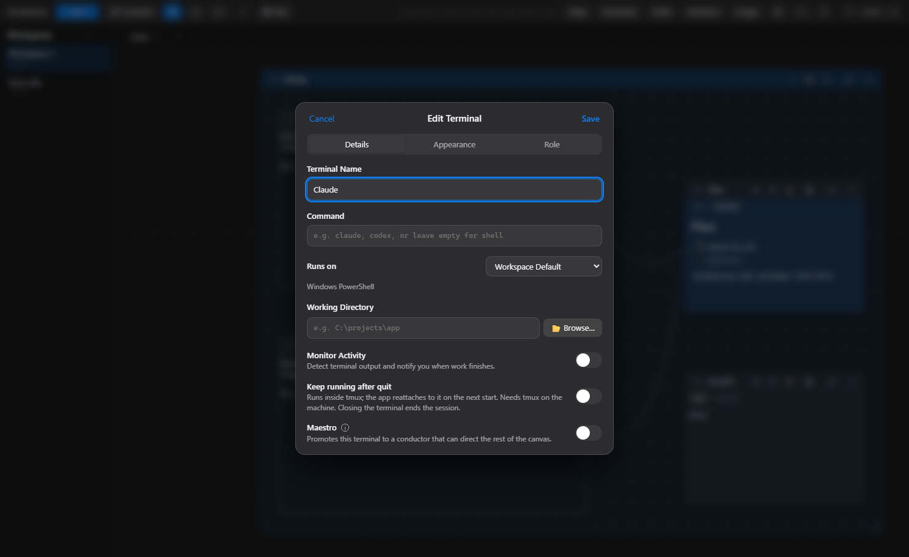

# OrchestrAI

**A spatial canvas for running AI coding agents side by side.** Arrange terminals, notes, git, files, browsers and Android devices on an infinite canvas, connect them with ropes, run each agent in an isolated git worktree ("floor"), and let a *Maestro* terminal conduct the rest. Works with Claude Code, Codex, OpenCode, Antigravity or any CLI. Built with Electron, xterm.js and node-pty.

> Independent open-source project. It is not affiliated with or endorsed by any similar product.

## Why OrchestrAI
- **Unlimited workspaces, free.** Create as many floors (separate canvases, each with its own folder, optionally an isolated git worktree) and as many terminals and nodes as your machine can handle. No workspace caps, no paid tiers, no license keys.
- **Free and open source (MIT).** Read it, fork it, change it. Your workspaces, notes and scrollback stay on your computer in plain JSON, with automatic backups and export/import.
- **Bring your own agents.** Not tied to one vendor: run Claude Code, Codex, OpenCode, Antigravity or any CLI side by side, each in a shell you configure (PowerShell, Git Bash, WSL, SSH, Docker).
- **Conductor built in.** A Maestro terminal can create, message and read other terminals through a local `orchestrai` CLI that listens on 127.0.0.1 only.
- **Safe parallel work.** Give each agent its own git worktree floor, review every diff, then land it with a no-fast-forward merge (or discard it).
- **Know what your agents are doing.** Live task manager with CPU, memory and time per terminal, plus per-provider token and limit tracking.
- **Local first.** No account, no telemetry, no cloud service required.

## Highlights
- **Infinite canvas** of terminals, notes, drawings, file trees, git, chat, portal (browser) and device nodes, with ropes, tidy layout, minimap and undo/redo.
- **Floors**: one canvas per task, optionally an isolated git worktree and branch, with setup/landing hooks and a reviewed merge back.
- **Multi-agent orchestration**: a Maestro terminal can create, message and read other terminals through the `orchestrai` CLI.
- **Agent awareness**: activity monitoring, notifications, task manager with CPU/memory, and token/limit tracking per provider.
- **Sessions that survive**: optional `tmux` persistence, scrollback restore, automatic backups.
- **Runs anywhere you work**: local shells, WSL, SSH and Docker containers; themes and fonts per terminal.

## Quick start
Requires [Node.js](https://nodejs.org/) 18+ and git. Windows is the primary platform; macOS and Linux are untested (help welcome).

    git clone https://github.com/adaumsilva/OrchestrAI.git
    cd OrchestrAI
    npm install
    npm start

If you launch from a VS Code or Claude Code shell, unset `ELECTRON_RUN_AS_NODE` first (`env -u ELECTRON_RUN_AS_NODE npm start` in Git Bash, `Remove-Item Env:ELECTRON_RUN_AS_NODE` in PowerShell).

## Screenshots

Regenerate them with `ORCH_TEST=tests/e2e/screenshots.script.js electron tests/e2e/entry.js`.

## Contributing
Contributions are welcome, including your first one.
- Browse [good first issues](https://github.com/adaumsilva/OrchestrAI/labels/good%20first%20issue) and [help wanted](https://github.com/adaumsilva/OrchestrAI/labels/help%20wanted).
- Issues are labeled by area (`area:canvas`, `area:terminal`, `area:agents`, `area:git`, ...) and priority. The full backlog is in [docs/roadmap/issues.md](docs/roadmap/issues.md).
- Read [CONTRIBUTING.md](CONTRIBUTING.md) for the code layout, how to add a node kind, and how changes are verified.

## Contents
[Canvas](#canvas) · [Floors](#floors) · [Terminal sheet](#terminal-sheet-new--edit-terminal) · [Terminals overview](#terminals-overview) · [Task manager](#task-manager) · [Themes](#themes) · [Terminals](#terminals) · [Nodes](#nodes) · [Workspace](#workspace) · [License](#license)

## Canvas
- Pan: drag the background. Zoom: wheel or the `-`/`+` buttons.
- Move a node: drag its header, or Alt+drag anywhere on it. Double-click the title to rename.
- Select several: Ctrl+click, Shift+click a header, or Shift+drag a box. `Ctrl+A` selects all. Dragging moves the whole group. `Delete` removes the selection.
- **Connect**: select a node, press `C` (or the Connect button / the link button on its header), then click another node. `Esc` cancels. Hover a rope and click `x` to remove it. Ropes are dashed, sag and swing, and light up when a note sends text through them.
- **Tidy** (`T`): arranges the selection, or all nodes. **Minimap** (`M`).
- **Undo / redo**: `Ctrl+Z`, `Ctrl+Shift+Z` / `Ctrl+Y` for nodes, ropes and layout. Undoing a closed terminal opens a fresh shell in its place.
- `Alt+]` / `Alt+[` cycle nodes, `Ctrl+PageDown` / `Ctrl+PageUp` cycle floors, `?` lists every shortcut.

## Floors
Tabs under the toolbar. Each floor is its own canvas with its own working directory. On a git repository a floor can be **isolated**: a git worktree on a new `orchestrai/...` branch. The tab menu (`⋮`) offers:
- **Hooks**: a *setup command* (typed into a terminal when the floor opens, or on demand) and a *check before landing* (runs in the floor's directory; a non-zero exit blocks landing until you press Land again to confirm).
- **Land**: review every changed file and its diff, optionally commit pending work, merge with `--no-ff` (aborting cleanly on conflict), then remove the worktree and branch.
- **Discard**: delete the worktree and branch.

## Terminal sheet (New / Edit Terminal)
**+ Add > Terminal** opens the sheet; **right-click a terminal** (body or header) > *Terminal settings…* edits an existing one.
- **Details**: name, command, *Runs on* (Workspace Default, Local with a chosen shell, WSL distro and user, SSH host/port/user, Docker container), working directory, **Monitor Activity** and **Maestro**. The **Quick start** row (Claude Code, Codex, Antigravity, OpenCode, Shell) fills in name, command and icon; presets are editable in Settings (up to 5 active).
- **Keep running after quit** (Details tab; Local, WSL and SSH): runs the terminal inside `tmux` so its processes survive closing the app. On the next start the app reattaches (status **Restored**) instead of starting a new shell, and does not retype the command or role. Closing the terminal node, or *Restart*, ends the tmux session. If `tmux` is not installed on that machine the terminal says so and starts normally. Settings can disable the feature globally and set the tmux socket name (default `orchestrai`, one `tmux -L` server shared by all terminals). Not available for Docker or custom profiles. On Windows, use WSL or SSH; native Windows has no tmux.
- **Appearance**: emoji icon, accent color (8 colors or custom), theme and font overrides, with a live preview. The font field has an **Installed fonts** list of monospace fonts, each previewed in its own face.
- **Role**: reusable roles (instructions for an agent). Starter roles are included; create, edit and delete your own. When the terminal has a command, the role text is pasted to the agent as its first message once it goes quiet after starting.
- **Monitor Activity**: each terminal shows a status dot (starting, running, idle, exited). When a burst of output ends and you are not looking at the terminal, its border pulses and, if the app is in the background, a desktop notification appears. Clicking the terminal clears it.
- **Maestro**: promotes a local terminal to a conductor. It gets the `orchestrai` command on its PATH:
  `orchestrai list | new --name N --command C [--role R] [--cwd DIR] | send <terminal> <text> | read <terminal> [--lines N] | close <terminal> | roles | peers | ask <peer> <text> | check <peer> | routine list|add|remove`.
  New terminals appear next to the Maestro, connected by a rope. The bridge listens on 127.0.0.1 only, with a per-run token that only Maestro terminals receive.

## Terminals overview
The **Terminals** toolbar button (or `L`) opens a panel listing every terminal on every floor with its status (starting, running, idle, restored, exited), floor and role. Terminals that need attention are listed first and counted in a badge on the button and in the tray tooltip. Click a row to jump to that terminal; focusing it clears its attention flag.

## Task manager
The **Tasks** toolbar button (or `K`) opens a live table of every terminal: the foreground process of its process tree, CPU (100% = one core), memory, uptime, time in the current status and total busy time, with CPU/memory sparklines. Terminals running a known agent (Claude Code, Codex, or any provider definition from **Usage**) also show **Tokens** (the shortest window) and **Limit** (highest percent used, amber from 80%; "no limit" when the provider reports none); hover for every window. These figures are per provider account, not per terminal, so two Claude terminals show the same numbers. Click a column to sort; click a row to jump to the terminal. Per row: Ctrl+C, end the running task (the shell stays), restart, copy pid. Rows turn amber when hot (80% CPU or 1 GB) and flag a task that produced no output for 5 minutes. Sampling (PowerShell/CIM on Windows, `ps` elsewhere) runs only while the panel is open.

## Themes
In **Settings** (⚙): pick a theme (Follow system, Dark, Light, Midnight, Solarized dark, or your own). *Follow system* switches between the **Light theme** and **Dark theme** you choose, following the OS appearance. **Custom themes** has a color editor (background, text, cursor, selection, 16 ANSI colors) and **Import…**, which reads xterm.js / VS Code style JSON and Windows Terminal color schemes. Each terminal can override the theme and font in its Appearance tab.

## Terminals
- **Shell profile** (button in the terminal header): Windows PowerShell, PowerShell 7, Command Prompt, Git Bash, every WSL distro and running Docker container are detected. You can also run any command (`ssh me@host`, `python -i`) and set a start directory. Applying restarts that terminal.
- **Settings** (⚙ in the toolbar): font family and size (with an installed-font picker), line height, cursor style and blink, scrollback, themes (see above), default profile, copy on select, Windows-style Ctrl+C / Ctrl+V, restoring recent output after restart, persistent tmux sessions, and your own saved profiles.
- **Find** (Ctrl+Shift+F, or ⌕) with match count and case toggle. **Right-click** for Copy, Paste, Select all, Find, Clear, Restart. Ctrl+Shift+C / Ctrl+Shift+V always copy and paste. Links open in your browser.
- When a process exits the terminal says so and Enter restarts it (or use ⟳). The node border flashes on the terminal bell. Recent output is saved and shown again after restarting the app.

## Nodes
- **Terminal**, **Note** (▶ sends its text to linked terminals, chats and devices), **Drawing** (freehand pad).
- **Files**: tree with git badges, search, create/rename/trash, text editor (Ctrl+S).
- **Git**: branches, stage/unstage/discard, diffs, commit, history, stash.
- **Chat**: runs an agent CLI per message with the prompt on stdin (default `claude -p --continue`, editable per node).
- **Portal**: embedded browser with a persistent session.
- **Device**: Android emulator or phone over `adb` (needs `adb` on PATH or in the Android SDK).

## Workspace
The `⋯` button opens export / import, a backup list and the backups folder. A backup is written every 10 minutes when something changed, and on quit (last 20 kept). A tray icon offers Show / Hide / Quit.
## License
[MIT](LICENSE) © 2026 Adam Silva

## Tests

`npm test` runs the unit tests (plain node) and then every `tests/e2e/*.test.js` in its own Electron process against a throwaway profile. `npm run test:e2e -- palette` runs the e2e files whose name contains `palette`. CI runs the same on Windows for every push and pull request.
